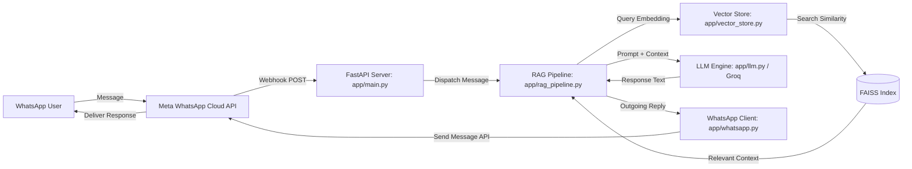

# AgriAssist – RAG-Based Agricultural WhatsApp Assistant

An AI-powered agricultural advisory assistant designed to provide contextual crop management and disease mitigation guidance directly through WhatsApp using Retrieval-Augmented Generation (RAG).


---

## 1. Overview

**AgriAssist** connects farmers and agricultural stakeholders directly with verified agronomic documentation through WhatsApp. Technical agronomy manuals, disease treatment guides, and pest management schedules are frequently difficult to navigate in real time. 

AgriAssist bridges this accessibility barrier by combining a WhatsApp messaging endpoint with a Retrieval-Augmented Generation (RAG) backend. Inbound queries are matched against domain literature using dense vector embeddings, providing factual, context-grounded responses via an LLM while minimizing hallucination.

---

## 2. Key Features

- **WhatsApp Conversational Interface:** Users send plain-text queries through WhatsApp without installing separate software.
- **Semantic Vector Search:** Employs Sentence Transformers and FAISS for sub-second semantic retrieval across embedded domain documents.
- **RAG-Grounded Answers:** Feeds retrieved technical excerpts directly into the prompt context for the Groq inference engine.
- **Automatic Index Initialization:** Ingests and indexes the agricultural reference dataset (`data/agriassist_dataset.pdf`) if a pre-existing vector store is not found at runtime.
- **Asynchronous Webhook Processing:** Implements FastAPI endpoints to handle Meta webhook verification challenges and asynchronous messaging dispatches.

---

## 3. System Architecture

The end-to-end request lifecycle operates as follows:

1. The farmer submits a natural language question via WhatsApp.
2. Meta's WhatsApp Cloud API forwards the event payload to the FastAPI `/webhook` endpoint.
3. The server validates the payload, extracts the query, and routes it to the RAG pipeline.
4. The query is converted into a dense vector embedding using `sentence-transformers`.
5. FAISS scans the local index to retrieve the most relevant agricultural text chunks.
6. The retrieved text and user query are assembled into an instruction prompt dispatched to the Groq API.
7. The synthesized response is sent back to the user's phone number via the WhatsApp Cloud API.



---

## 4. Technology Stack

| Layer | Technology | Purpose in Project |
| :--- | :--- | :--- |
| **API Framework** | FastAPI, Uvicorn | Asynchronous HTTP endpoints and webhook listener |
| **LLM Inference** | Groq API (`groq`) | High-speed response generation with open-weights LLMs |
| **Vector Indexing** | FAISS (`faiss-cpu`) | Dense vector similarity retrieval |
| **Embeddings** | Sentence Transformers (`sentence-transformers`) | Vector representation of queries and document chunks |
| **Document Parsing** | PyMuPDF (`fitz`) | Text extraction from source agricultural PDFs |
| **Messaging Integration** | Meta WhatsApp Cloud API (`requests`) | Inbound webhook processing and outbound message delivery |
| **Configuration** | `python-dotenv` | Environment variable management |

---

## 5. Project Structure

```text
AgriAssist-RAG-WhatsApp-AI/
├── app/
│   ├── __init__.py
│   ├── main.py              # FastAPI app initialization, routes, and webhook handling
│   ├── llm.py               # Groq client configuration and prompt execution
│   ├── rag_pipeline.py      # Orchestrates similarity retrieval and answer synthesis
│   ├── vector_store.py      # PDF parsing (PyMuPDF), chunking, and FAISS indexing
│   └── whatsapp.py          # WhatsApp Cloud API verification and message dispatch
├── data/
│   └── agriassist_dataset.pdf # Agricultural reference dataset
├── .env.example             # Template for required environment variables
├── requirements.txt         # Project dependencies
└── README.md
```

---

## 6. Installation & Setup

### Prerequisites
- Python 3.10 or higher
- Git
- Meta for Developers account with access to the WhatsApp Cloud API
- Groq Cloud API Key

### 1. Clone the Repository
```bash
git clone https://github.com/Codeabc27/AgriAssist-RAG-WhatsApp-AI.git
cd AgriAssist-RAG-WhatsApp-AI
```

### 2. Create and Activate a Virtual Environment
- **Windows (Command Prompt / PowerShell):**
  ```powershell
  python -m venv venv
  .\venv\Scripts\activate
  ```
- **Linux / macOS:**
  ```bash
  python3 -m venv venv
  source venv/bin/activate
  ```

### 3. Install Dependencies
```bash
pip install --upgrade pip
pip install -r requirements.txt
```

---

## 7. Environment Configuration

Create a `.env` file in the project root:

```bash
cp .env.example .env
```

Define the following environment variables:

```ini
# Meta WhatsApp Cloud API Credentials
WHATSAPP_TOKEN=your_meta_access_token_here
WHATSAPP_PHONE_NUMBER_ID=your_whatsapp_phone_number_id_here
VERIFY_TOKEN=your_custom_webhook_verification_token

# Groq API Configuration
GROQ_API_KEY=gsk_your_groq_api_key_here
```

### Variable Details:
- `WHATSAPP_TOKEN`: Permanent system user token or temporary developer token from Meta.
- `WHATSAPP_PHONE_NUMBER_ID`: The Phone Number ID assigned in the Meta WhatsApp App dashboard.
- `VERIFY_TOKEN`: A secret string created by you to verify webhooks with Meta.
- `GROQ_API_KEY`: API access key generated in the Groq Cloud console.

---

## 8. Running the Application

### 1. Launch the Server
Run the FastAPI application using Uvicorn:

```bash
uvicorn app.main:app --host 0.0.0.0 --port 8000 --reload
```

Upon initial startup, `app/vector_store.py` will read `data/agriassist_dataset.pdf`, chunk its contents, calculate embeddings, and build the in-memory FAISS vector index.

### 2. Configure Local Webhook Tunnel
Meta requires an HTTPS endpoint to register your webhook. In a separate terminal, start a tunneling tool such as `ngrok`:

```bash
ngrok http 8000
```

### 3. Connect to Meta Developer Portal
1. Go to your app dashboard at **Meta for Developers** → **WhatsApp** → **Configuration**.
2. Under **Webhook**, click **Edit**.
3. Set **Callback URL** to: `https://<your-ngrok-url>.ngrok-free.app/webhook`.
4. Set **Verify Token** to match the `VERIFY_TOKEN` in your `.env` file.
5. Click **Verify and Save**.
6. Under **Webhook Fields**, subscribe to `messages`.

---

## 9. API Endpoints

### `GET /`
- **Description:** Basic service health status.
- **Response:**
  ```json
  {
    "status": "active",
    "message": "AgriAssist API is running"
  }
  ```

### `GET /webhook`
- **Description:** Meta challenge handshake endpoint. Validates `hub.verify_token` against `VERIFY_TOKEN` and echoes `hub.challenge`.

### `POST /webhook`
- **Description:** Inbound messaging endpoint. Receives events from Meta, extracts question text from incoming WhatsApp messages, triggers the RAG workflow, and sends the answer back to the sender.

---

## 10. How the RAG Pipeline Works

```
data/agriassist_dataset.pdf
         │
         ▼ (PyMuPDF text extraction)
    Raw Text
         │
         ▼ (Fixed-size character chunking with overlap)
    Text Chunks
         │
         ▼ (SentenceTransformers: all-MiniLM-L6-v2)
  Chunk Vectors ────► [ FAISS Index ]
                             ▲
                             │ (Similarity Search)
Farmer Query ──────► Query Vector
                             │
                             ▼
                    Top-K Document Chunks
                             │
                             ▼
                     Prompt Compilation
                             │
                             ▼
                   Groq Inference Engine
                             │
                             ▼
                  Answer Sent to WhatsApp
```

1. **Document Parsing:** `PyMuPDF` reads and cleans text from `data/agriassist_dataset.pdf`.
2. **Text Chunking:** Extracted text is split into chunks to preserve localized context.
3. **Embedding Generation:** The `sentence-transformers/all-MiniLM-L6-v2` model converts chunks into 384-dimensional dense vectors.
4. **FAISS Storage:** Vectors are loaded into a FAISS index for quick vector distance querying.
5. **Contextual Retrieval:** Incoming user questions are embedded using the same transformer, and the top matching excerpts are retrieved.
6. **LLM Generation:** The context chunks and user question are injected into the Groq API call, generating a concise, actionable answer tailored for mobile chat.

---

## 11. Current Limitations

- **Text-Only Ingestion:** The current implementation processes text queries only. Image inputs (such as crop disease identification from photos) are not yet supported.
- **Knowledge Base Scope:** The system retrieves answers exclusively from the provided `agriassist_dataset.pdf`. Topics not covered in this document cannot be referenced factually.
- **Session State:** Conversational memory across multiple messages is stateless; each question is processed independently without multi-turn history.

---

## 12. Future Enhancements

- [ ] Add conversation history memory per telephone number using Redis or SQLite.
- [ ] Implement computer vision leaf disease diagnosis using MobileNetV2 / CNN models.
- [ ] Add multilingual and local language support (e.g., Hindi, Tamil, Telugu).
- [ ] Implement automated RAG evaluation metrics using the Ragas framework.
- [ ] Add automated Docker containerization and CI/CD pipelines.

---

## 13. Contributing

Contributions are welcome. Please follow these steps:

1. Fork the repository.
2. Create a topic branch: `git checkout -b feature/improvement-name`.
3. Commit your changes: `git commit -m "feat: description of changes"`.
4. Push to your branch: `git push origin feature/improvement-name`.
5. Open a Pull Request.

---

## 14. License

This repository is distributed under the terms specified in the repository's [LICENSE](LICENSE) file. If no license file is present, standard copyright laws apply.